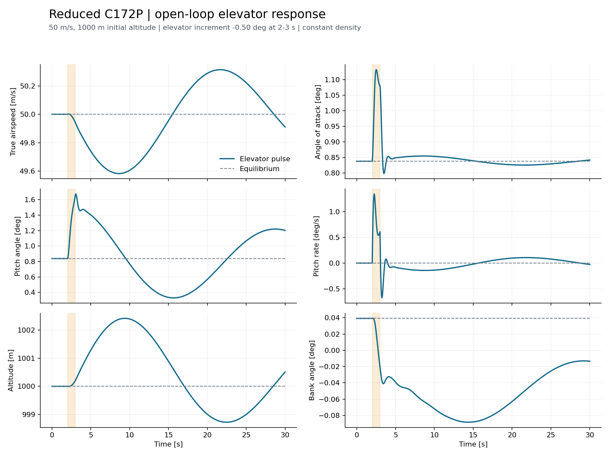
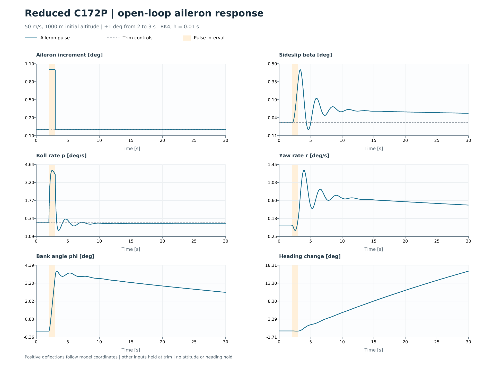
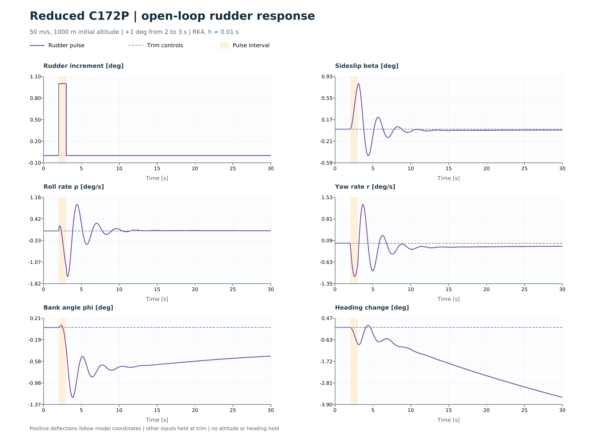
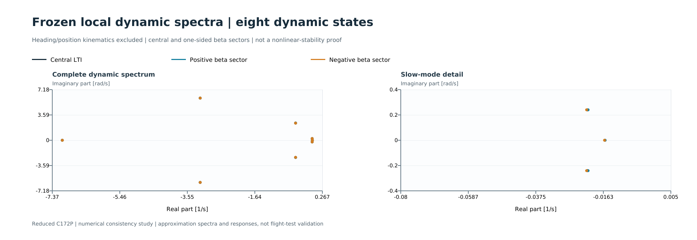
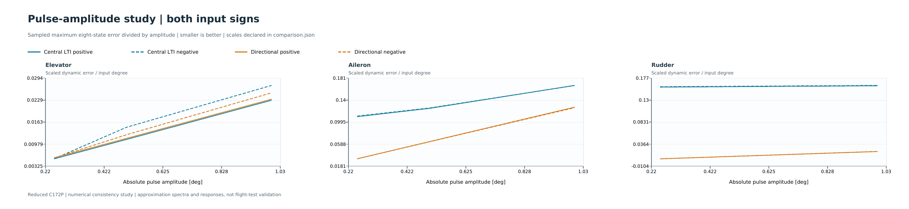
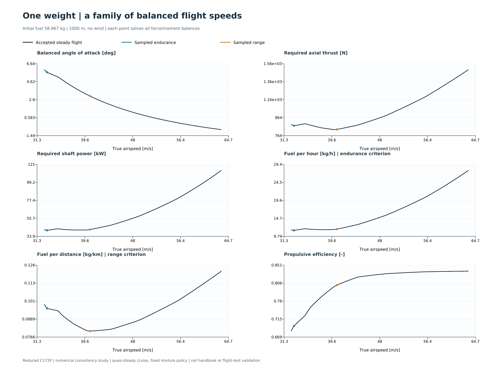
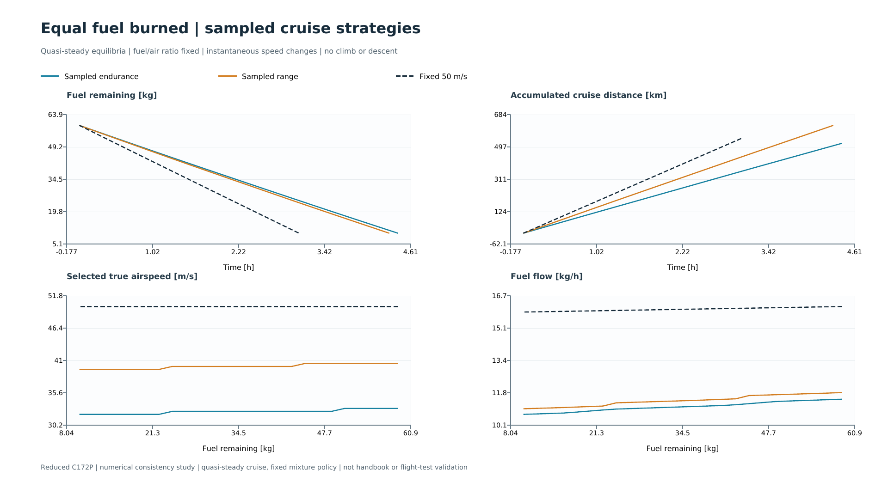

# Educational C172P 6-DOF simulation

[](https://github.com/JavierTejedor02/c172-6dof-flight-model/actions/workflows/verification.yml)

**Version 0.5.0 - stationary propulsion, depleting-fuel cruise missions and sampled endurance/range comparisons.**

A Python implementation of nonlinear rigid-body flight dynamics using true airspeed, angle of attack and sideslip as velocity states. It includes straight-and-level trim, independent longitudinal/lateral pulses, an integrator comparison, local perturbation matrices, candidate dynamic modes, linear/nonlinear response comparisons and a separate quasi-steady cruise/fuel study.

The implementation evaluates the forces and moments and implements Newton-Euler dynamics and Euler-angle kinematics. Explicit Euler and classical RK4 are implemented as readable fixed-step formulas; SciPy supplies the default trim optimizer and adaptive DOP853 integrator. The performance sweep also offers a NumPy Newton trim backend and a stationary adaptation of the source propulsion equations. **JSBSim is not run or imported.**

The aircraft data come from a pinned public JSBSim representation of a 1982 Cessna 172P. This is a deliberately reduced model, not a reproduction of the full JSBSim aircraft.

## Longitudinal response

The elevator example applies a -0.5 degree increment from 2 to 3 seconds. Other controls remain at trim.



## Lateral-directional responses

The following experiments start independently from the same 50 m/s, 1000 m equilibrium. A +1 degree effective-aileron increment or a +1 degree rudder increment is held from 2 to 3 seconds; all other inputs stay at trim. After release, the surface returns to its trim deflection. Attitude and heading evolve freely because no feedback controller is active.

The bundled lateral results use RK4 with a 0.01 s step and the checked recorded equilibrium. Halving the step to 0.005 s passed the recorded refinement check in [lateral_run.json](results/lateral/lateral_run.json). The elevator figure above is the original DOP853 example. These are reduced-model numerical responses, not flight-test validation.

### Effective-aileron pulse

Positive effective aileron initially produces positive roll acceleration in this model. The response also includes sideslip and yaw, and the residual bank continues to change the heading after the pulse ends.



### Rudder pulse

Positive model rudder initially produces negative yaw acceleration. The response includes coupled sideslip and roll. Signs refer to the implemented surface coordinates, not a normalized cockpit-command convention.



| Quantity | Aileron pulse | Rudder pulse |
|---|---:|---:|
| Surface increment relative to trim | +1 deg | +1 deg |
| Maximum absolute sideslip | 0.448 deg | 0.801 deg |
| Maximum absolute bank change from initial trim | 3.953 deg | 1.280 deg |
| Heading change at 30 s | +16.637 deg | -3.535 deg |

See [lateral experiments](docs/05_lateral_experiments.md) for reproduction, control signs, numerical evidence and interpretation.

## Local models and candidate dynamic modes

The local-model study exports the full twelve-state A and B matrices and analyzes eight dynamic states, excluding neutral heading/position kinematics. The smooth central approximation identifies candidate phugoid, short-period, Dutch-roll, roll-subsidence and spiral modes. Full coupling is retained.

The drag term `CDbeta * abs(beta)` has different left/right derivatives at the zero-sideslip trim. The study therefore reports a central LTI approximation and a directional, piecewise-linear approximation that retains this first-order effect. The original nonlinear aerodynamics are unchanged. Frozen local spectra do not prove nonlinear stability or real-aircraft accuracy.



Eighteen pulse comparisons cover elevator, aileron and rudder inputs at +/-0.25, +/-0.5 and +/-1 degree. The differentiation increments and representative integration steps are independently refined. The normalized-error study exposes the central approximation's lateral error floor at the beta corner:



| Analysis output | File |
|---|---|
| Full ordered matrices | [A](results/linear_analysis/A.csv), [B](results/linear_analysis/B.csv) |
| Candidate eigenvalues, periods and damping | [Modal report](results/linear_analysis/modes.md) |
| Longitudinal linear/nonlinear response | [Elevator comparison](results/linear_analysis/longitudinal_linear_nonlinear.png) |
| Lateral linear/nonlinear responses | [Aileron](results/linear_analysis/aileron_linear_nonlinear.png), [rudder](results/linear_analysis/rudder_linear_nonlinear.png) |
| All case metrics and refinement evidence | [Comparison report](results/linear_analysis/comparison.json) |

See [local models and modes](docs/06_local_models_and_modes.md) for derivation, control/state ordering, the nonsmooth treatment, reproduction and limits.

## Cruise performance, endurance and range

Weight determines the lift required, while speed and angle of attack can trade off to produce it. Each accepted speed below is a newly balanced flight of the same initial load. Minimum fuel per hour favors endurance; minimum fuel per kilometre favors range. Source motor losses and propeller efficiency are included in the consumption calculation.



The mission study recalculates mass, CG, inertia, trim and propulsion as fuel decreases. It compares sampled endurance/range selections with a constant 50 m/s reference, all starting with 58.967 kg fuel and retaining 10 kg. The retained amount is an illustrative analysis choice, not an operational reserve rule.



Bundled model results for that common 48.967 kg fuel burn:

| Sampled strategy | Cruise duration [h] | Cruise distance [km] | Initial speed [m/s] |
|---|---:|---:|---:|
| Endurance selection | 4.44 | 518 | 33.0 |
| Range selection | 4.31 | 621 | 40.5 |
| Fixed-speed reference | 3.06 | 550 | 50.0 |

These are idealized cruise segments at 1000 m with no wind, fixed fuel/air ratio and cost-free speed transitions. Finite speed samples and the reduced model domain constrain the results. A selected feasible-speed edge is explicitly flagged; it must not be presented as a proven real-aircraft optimum. See the [results summary](results/performance/summary.md), [numerical report](results/performance/performance.json) and [performance guide](docs/07_cruise_performance.md). Neither the reduced aerodynamics nor fuel flow has been validated against the C172P handbook.

## Quick start on Windows

Prerequisites: Python 3.11 or newer with `venv` and `pip`, and PowerShell. Installation requires internet access unless the dependencies are available locally. NumPy, SciPy and Matplotlib are listed in `requirements.txt`.

Open PowerShell in the repository root: the directory containing `run_longitudinal_demo.py`, `requirements.txt`, `c172sim/` and `data/`. The folder name and its parent directory do not affect the model; all commands below assume this working directory.

For a new checkout, clone the repository and enter the directory created by Git:

```powershell
git clone https://github.com/JavierTejedor02/c172-6dof-flight-model.git
Set-Location '.\c172-6dof-flight-model'
```

For an existing checkout or an extracted archive, open the repository root and skip the clone commands. Confirm the working directory before installation:

```powershell
Get-Item run_longitudinal_demo.py, requirements.txt
```

Run all commands below from that package root:

```powershell
python --version
python -m venv .venv
.\.venv\Scripts\python.exe -m pip install -r requirements.txt
.\.venv\Scripts\python.exe run_longitudinal_demo.py
```

Using the virtual environment's Python directly avoids changing PowerShell execution policy. If `python` is not recognized but the Windows Python launcher is installed, use `py -3 --version` and `py -3 -m venv .venv` for the first two commands. Subsequent commands use the environment's executable explicitly.

An existing Python environment, including the interpreter selected in VS Code, can also be used. Confirm its dependencies with `python -c "import numpy, scipy, matplotlib"`, then run `python run_longitudinal_demo.py` or `python run_lateral_demo.py`. On Windows, `py -3` can replace `python` when using the Python launcher. The `.venv` commands require that environment to have been created first.

The packaged data are ready to use; the XML download is needed only to reproduce data preparation.

Dependency ranges are listed in `requirements.txt`. Each study records its solver settings and execution environment in its JSON report.

## Run and inspect

```powershell
.\.venv\Scripts\python.exe tools/verify_project.py
.\.venv\Scripts\python.exe run_longitudinal_demo.py --duration 30 --pulse-deg -0.5
.\.venv\Scripts\python.exe run_longitudinal_demo.py --help
```

The demonstration first solves a 50 m/s, 1000 m level-flight target, then integrates equilibrium and perturbed trajectories. Elevator is reduced by 0.5 degrees from trim between 2 and 3 seconds. The input is split into segments so the integrator handles the discontinuities explicitly.

The demonstration prints the output directory, trim angle of attack, elevator deflection, thrust and equilibrium altitude drift. For the packaged configuration, expected trim values are approximately 0.837817 deg, 3.741428 deg and 1012.872252 N respectively. Small numerical differences may occur between environments. Complete verification runs through `tools/verify_project.py`: success requires all discovered tests to pass, with none skipped. An empty suite or a missing dependency fails verification.

Files generated by `run_longitudinal_demo.py` in `results/longitudinal/`:

| File | Content |
|---|---|
| `response.png` | Six plots comparing equilibrium and the elevator response |
| `equilibrium.csv` | Full 12-state equilibrium time history and controls |
| `elevator_pulse.csv` | Full 12-state perturbed time history and controls |
| `trim_and_run.json` | Trim values, residuals, environment and run metadata |

Verification writes the test output to `results/verification/tests.txt` and a machine-readable result to `results/verification/summary.json`. The JSON includes the test counts, Python/package versions, platform and verification status. These generated local reports are excluded from Git. To inspect a fresh run in PowerShell:

```powershell
.\.venv\Scripts\python.exe tools/verify_project.py
Get-Content results/verification/summary.json
```

The demonstration replaces files with the same names in its output directory. Use `--output-dir results/custom_run` to retain a separate experiment. Duration must be finite and greater than 3 seconds; `--pulse-deg` must be finite. A large pulse may exceed the documented study domain and stop integration. Plots are saved to disk without opening an interactive window.

## Compare longitudinal numerical integrators

For an integrator comparison, run:

```powershell
.\.venv\Scripts\python.exe compare_longitudinal_integrators.py
```

This uses the same elevator pulse with Euler, RK4 and DOP853 at four step settings, compares each trajectory with a refined numerical reference, and measures RHS evaluations and median integration time. Reports, trajectory CSVs and two figures are written to `results/longitudinal_integrator_comparison/`. Failed candidates are reported without accuracy scores. The script also runs with defaults using an editor's Python Run action.

To inspect one simple integrator separately:

```powershell
.\.venv\Scripts\python.exe run_longitudinal_demo.py --method EULER --step-size 0.025 --output-dir results/euler_demo
.\.venv\Scripts\python.exe run_longitudinal_demo.py --method RK4 --step-size 0.05 --output-dir results/rk4_demo
```

`--step-size` is fixed for Euler/RK4 and a maximum adaptive step for DOP853, which remains the default. See [integrators and comparison](docs/04_integrators.md) for formulas, parameter meanings, metrics, reference checks and limitations.

## Run the lateral experiments

```powershell
.\.venv\Scripts\python.exe run_lateral_demo.py
```

This recomputes trim and runs an equilibrium baseline plus separate aileron and rudder pulses. Defaults are +1 degree from 2 to 3 seconds, 30 s total duration and DOP853. Select another input with `--aileron-deg` or `--rudder-deg`, and adjust the interval with `--pulse-start` and `--pulse-duration`. Other controls remain fixed at trim.

To reproduce the numerical settings used for the bundled README figures:

```powershell
.\.venv\Scripts\python.exe run_lateral_demo.py --method RK4 --step-size 0.01 --trim-file results/longitudinal/trim_and_run.json --check-step
```

`--check-step` repeats a fixed-step experiment at half the step, rejects a failed refinement check and records measured differences in JSON. With an existing environment, `py -3 run_lateral_demo.py` is also valid after installing the dependencies for that interpreter. The script can be launched using an editor's Python Run action.

Outputs in `results/lateral/`: `equilibrium.csv`, `aileron.csv`, `rudder.csv`, `lateral_run.json`, `aileron_response.png` and `rudder_response.png`. The JSON records the initial condition, actual controls, solver, environment and response metrics. An incompatible or unbalanced recorded trim is rejected. Files with the same names are replaced on each run; use `--output-dir` to preserve a separate experiment.

## Run the local-model study

```powershell
.\.venv\Scripts\python.exe run_linear_analysis.py
```

To reuse the checked reference trim:

```powershell
.\.venv\Scripts\python.exe run_linear_analysis.py --trim-file results/longitudinal/trim_and_run.json
```

This writes matrices, modal reports, eighteen linear/nonlinear comparisons, an amplitude sweep and figures to `results/linear_analysis/`. Default integration is RK4 with a 0.01 s step; the positive largest pulse for each surface is checked at 0.005 s. `--no-plots` writes numerical outputs without rendering figures.

## Run the cruise performance study

From the repository root, after installing the declared dependencies:

```powershell
.\.venv\Scripts\python.exe run_performance_analysis.py
```

The command prints feasible-speed counts for each fuel load, then duration/distance summaries for three strategies. It writes operating points, rejected points, mission CSVs, JSON/Markdown summaries and two figures to `results/performance/`. Both fuel and speed grids are refined by default; computation may take several minutes. `--no-plots` supports a NumPy-only numerical run. `--help` lists configuration options, including initial/retained fuel and fixed reference speed. Use `--output-dir` to preserve a separate study.

This calculation is a sequence of equilibria with a stationary motor/propeller model. The twelve-state dynamic runners continue to use fixed mass and prescribed thrust. A dynamic fuel state, autopilot and takeoff/climb/descent mission are not implemented.

## Experiment names and result directories

| Entry point | Study | Default results |
|---|---|---|
| `run_longitudinal_demo.py` | Elevator pulse and trim baseline | `results/longitudinal/` |
| `run_lateral_demo.py` | Independent aileron and rudder pulses | `results/lateral/` |
| `compare_longitudinal_integrators.py` | Euler/RK4/DOP853 on the elevator pulse | `results/longitudinal_integrator_comparison/` |
| `run_linear_analysis.py` | Coupled local models, modes and all three control pulses | `results/linear_analysis/` |
| `run_performance_analysis.py` | Stationary propulsion, fuel depletion and sampled cruise strategies | `results/performance/` |

Each study has its own result directory. Aircraft dynamics, frame transformations and integrators are shared by longitudinal and lateral experiments.

## Read the code

Longitudinal and lateral labels identify the experiments. The common aircraft, dynamics, frame transformations and integrators retain the full coupled 6-DOF model.

| File | Role |
|---|---|
| `c172sim/frames.py` | Body/wind/NED transformations and Euler kinematics |
| `c172sim/aircraft.py` | Reduced aerodynamic model, prescribed thrust and moments about loaded CG |
| `c172sim/dynamics.py` | Newton-Euler equations and the 12-state derivative function |
| `c172sim/trim.py` | Numerical level-flight equilibrium calculation |
| `c172sim/integrators.py` | Explicit Euler and classical RK4 step formulas |
| `c172sim/simulation.py` | Segmented integration with Euler, RK4 or SciPy DOP853 |
| `run_longitudinal_demo.py` | Longitudinal elevator pulse, equilibrium baseline and plots |
| `run_lateral_demo.py` | Independent aileron/rudder experiments and lateral response plots |
| `compare_longitudinal_integrators.py` | Longitudinal integrator accuracy/cost comparison |
| `run_linear_analysis.py` | Local matrices, candidate modes, amplitude sweeps and nonlinear comparisons |
| `c172sim/linearization.py` | Smooth-part Jacobians, exact drag cusp split and modal participation |
| `c172sim/analysis_plots.py` | Plot definitions and Matplotlib renderer for the local-model study |
| `c172sim/experiments.py` | Control pulses, independent lateral runs and recorded-trim checks |
| `c172sim/reporting.py` | Shared trajectory CSV export |
| `tools/audit_reference.py` | Original source audit and SI conversions |
| `tools/build_model_data.py` | Loaded inertia assembly and reduced-model data extraction |
| `tests/test_simulation.py` | Analytic mechanics and integration checks |
| `tests/test_integrator_steps.py` | Analytic convergence and coupled-state checks of the simple formulas |
| `tests/test_fixed_simulation.py` | Fixed-step flight, control-boundary and sampling checks |
| `tests/test_longitudinal_integrator_metrics.py` | Longitudinal benchmark error scaling and reference timestamp checks |
| `tests/test_lateral_experiments.py` | Lateral control signs, pulse isolation, refinement and trim reuse |
| `tests/test_linearization.py` | Drag split, local-order checks, modal invariance, comparison and export |
| `c172sim/propulsion.py` | Source-derived stationary engine/propeller matching, flow and losses |
| `c172sim/mass_properties.py` | Independent load snapshots as both tanks deplete equally |
| `c172sim/performance.py` | Speed samples, per-load equilibria, fuel-coordinate missions and refinement |
| `c172sim/performance_plots.py` | Cruise-performance and mission chart definitions |
| `run_performance_analysis.py` | Performance-study configuration, results and figures |
| `tools/build_propulsion_data.py` | Identity-checked propulsion data preparation |
| `tools/verify_project.py` | Complete-suite verification, dependency checks and test reports |
| `.github/workflows/verification.yml` | Windows/Linux verification on pushes and pull requests |
| `tests/test_performance.py` | Changing loads, steady balances, objective differences, matching and mission checks |

The [technical overview](docs/00_technical_overview.md) describes the architecture and engineering decisions. The [equation-to-code reference](docs/03_equations_and_code.md) documents the governing equations and their implementation.

## State and inputs

State order:

`[Va, alpha, beta, p, q, r, phi, theta, psi, xN, xE, xD]`

Body axes: x forward, y right, z down. Position: local NED. Attitude: Euler 3-2-1. Air data refer to air-relative velocity; the initial model has no wind.

Inputs are actual elevator, effective-aileron and rudder deflections in radians, plus prescribed axial thrust in newtons. The aileron input is the aerodynamic effective deflection, not an individual left/right surface or a normalized cockpit command.

## Configuration and first result

One pilot, half capacity in each tank, other point masses zero; fuel mass is held fixed in the dynamic pulse examples. The separate performance study depletes the tanks equally. Flaps are zero. Density is the ISA value at 1000 m and is held constant in these studies.

| Quantity | Example result |
|---|---:|
| Loaded mass | 804.67286438 kg |
| Trim angle of attack | 0.837817 deg |
| Trim elevator | 3.741428 deg |
| Trim thrust | 1012.872252 N |
| Maximum altitude drift in the 30 s equilibrium run | about 2.1e-10 m |

The loaded inertia includes point-mass shifts and the source liquid-tank self-inertia convention. The left-seat pilot creates a small lateral CG offset; the trim solver allows small bank, aileron and rudder offsets rather than forcing an exactly symmetric equilibrium.

Tiny equilibrium drift demonstrates numerical consistency at the computed equilibrium. It does not establish physical accuracy.

## Verification

The [Verification workflow](https://github.com/JavierTejedor02/c172-6dof-flight-model/actions/workflows/verification.yml) runs on pushes and pull requests using Windows, Linux and Python 3.12. It installs the declared dependencies, checks compatibility and runs `python tools/verify_project.py`. Verification requires a nonempty suite with all tests passing and no skips. Each job provides its test log and environment metadata as downloadable artifacts.

The suite covers reference frames, analytic mechanics, mass properties, trim balance, equilibrium persistence, integration convergence, control boundaries, local perturbation models, propulsion matching and fuel-coordinate missions. Study-specific refinement checks are recorded with the numerical results. The badge above shows the current status; detailed results are available in GitHub Actions.

## Model limitations

There is no quantitative comparison with a JSBSim execution or flight-test data yet.

Simplifications are explicit in [the audit](docs/02_data_audit.md) and the data JSON. They include omitted alpha-rate contributions and the additional multidimensional lift term in the upstream c172x file; no stall hysteresis, ground effect, flaps, wind, actuators or ground contact. The 6-DOF dynamic runners omit engine/propeller dynamics and fuel burn, and use prescribed thrust. The separate performance study adds stationary propulsion and fuel bookkeeping; its source-derived motor model is not independently validated.

The model monitors its documented airborne study domain. These numerical study bounds are not certified aircraft operating limits. A trajectory leaving the domain stops with an error.

## Reproduce source preparation

Source preparation is optional for running the packaged demonstration. Download the exact upstream XML as `c172x.xml`, preserving its bytes and line endings, from:

https://raw.githubusercontent.com/JSBSim-Team/jsbsim/c455897049e044860b3c282e955daca1d0a785fe/aircraft/c172x/c172x.xml

In the commands below, replace `C:\path\to\c172x.xml` with the downloaded file's actual path. From the package root, run both stages:

```powershell
.\.venv\Scripts\python.exe tools/audit_reference.py --source 'C:\path\to\c172x.xml' --output-dir data
.\.venv\Scripts\python.exe tools/build_model_data.py --source 'C:\path\to\c172x.xml' --output-dir data
```

The first stage writes the raw inventory and provisional load case; the second completes the loaded inertia and generates the runnable reduced-model data. Both stages must be run to regenerate the completed data set. They replace `data/c172_reference.json`, `data/load_case_v0.json` and `data/c172_reduced_model.json`. A source-identity error indicates that the supplied XML does not match the pinned Git blob; obtain the raw file at the specified revision without newline conversion.

## Version control

The Git repository root is the directory containing this README and `run_longitudinal_demo.py`. Source auditing, data preparation, simulation, documentation and tests are maintained together in this repository.

Keep one working checkout and use Git commits for its history. Release identifiers such as `0.1.0` describe the software version, not a required directory name. Git tags can identify releases without creating duplicate project folders.

After cloning the repository, run the installation commands above from its root. Before starting a new editing session, synchronize the current branch:

```powershell
git pull --ff-only
git status
```

After editing, review the changes and run the verification suite. Stage the intended files explicitly, then commit and push. For example, after a README-only update:

```powershell
git diff
git add README.md
git diff --cached
git commit -m "Clarify setup instructions"
git push
```

Local edits reach GitHub after a successful push. Changes made through GitHub's web editor reach the local checkout after a successful pull. If a pull reports local changes or diverging history, resolve those changes before continuing; do not overwrite them with a forced update.

See [third-party notices](THIRD_PARTY_NOTICES.md) for attribution.
